# 枝见 Zhijian

枝见是一个基于 C# 和 Avalonia 的本地 Markdown-first 脑图编辑器。它把大纲、Markdown 文本和图形脑图绑定到同一份文档模型上，适合写文章提纲、梳理功能设计和整理项目结构。


仓库地址：<https://github.com/dotnet9/Zhijian>

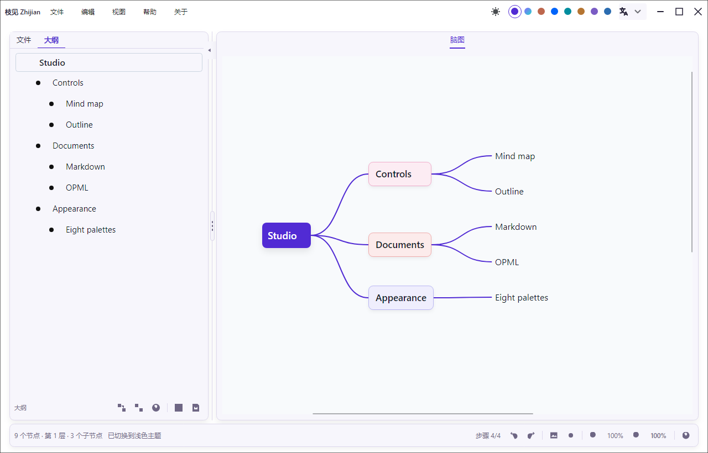

当前正式 Windows NativeAOT 的真实控件离屏截图，使用隔离的 Studio 样例树。本次静态图来自 `12.1.0.17` 的 NativeAOT 界面验证器；当前结果见[验收记录](docs/UI-VERIFICATION.md)，此前截图与历史媒体来源保留在[媒体复核记录](docs/recheck24-native-media.md)。

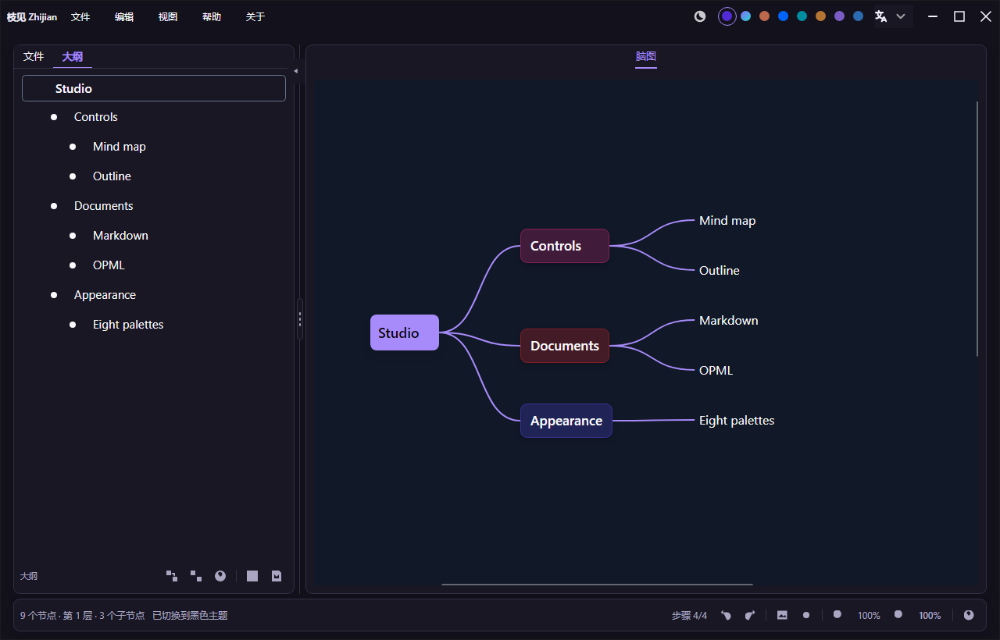

## 下载安装

从 [GitHub Releases](https://github.com/dotnet9/Zhijian/releases/latest) 下载最新安装包（附 `.sha256` 校验）：


- Windows x64：`Zhijian-v*-win-x64-setup.exe`（简体中文安装向导）
- Linux x64 / arm64：`Zhijian-*-linux-x64.deb`、`Zhijian-*-linux-arm64.deb`
- macOS x64 / arm64：`Zhijian-*-osx-x64.dmg`、`Zhijian-*-osx-arm64.dmg`

## 仓库规范

- 当前版本：`12.1.0.17`，版本号统一维护在根目录 `Directory.Build.props` 的 `<Version>` 节点。
- `CodeWF.Avalonia.MindView` 库统一目标 `net10.0`；桌面应用、测试与内部应用项目统一使用 `net10.0` / `net10.0-windows`。
- 根目录 `logo.svg`、`logo.png`、`logo.ico` 是唯一图标源，子工程只通过 MSBuild `Link` 引用，不维护图标副本。
- 运行时帮助、Markdown 示例、内置备忘录、设计说明等业务文档按功能保留；仓库级入口文档使用根目录 `README.md` 和 `UpdateLog.md`。

## 功能亮点

- 启动后默认创建空白脑图，随程序输出的 `使用手册.md` 可从“帮助 -> 打开使用手册”手动载入，用作多层级示例和帮助手册。
- 空白脑图提供“产品方案 / 会议纪要 / 学习笔记”快速模板，也可从“文件 -> 从模板新建”进入，降低首次起步成本。
- 文件菜单支持新建、新建窗口、打开可编辑文件、导入、打开文件夹、最近文件、保存、另存为可编辑格式、打开文件位置和关闭。
- 编辑菜单支持撤销、重做、添加同级、添加子级、提升、降级、上移、下移、删除节点和复制为 Markdown。
- 标题栏左侧保留文件、编辑、视图、帮助和关于菜单，右侧提供模式循环、八色圆点与语言图标列表。
- 语言切换使用 `CodeWF.Avalonia.Lang` 资源，覆盖中文简体、中文繁体、英语和日语。
- 首次启动新手引导会精准高亮标题栏文件菜单、大纲编辑区、Markdown 切换、脑图画布和底部导航，并提供“跳过”按钮。
- `src/Zhijian/App.config` 集中管理新手引导、默认语言、最近文件数、历史步数和运行状态文件名。
- 左侧提供“文件 / 大纲”两个 Tab：空文件页可直接打开可编辑文件、导入、打开文件夹或打开使用手册；单独打开或导入的文件会出现在文件列表中；打开文件夹时会列出该目录下所有支持文件。
- 大纲、Markdown 和脑图视图共享同一棵 `MindMapNode` 树。
- 大纲和脑图都支持标题、备注内联编辑。
- 大纲和脑图菜单提供添加同级、添加子级、提升、降级、上移、下移、备注和删除等高频操作。
- 脑图支持拖拽中心主题或画布平移、缩放、回到中心主题，以及基于真实节点坐标的小图导航。
- 复制为 Markdown 会把当前文档 Markdown 写入剪贴板，并显示桌面全局消息。
- “打开/另存为”聚焦 Markdown、OPML、XMind 等可编辑格式；“导入”覆盖更多只读转换格式，避免误以为能原格式保存。
- 应用外壳提供标题栏菜单、对话框、列表控件、ToolTip、全局消息和深色主题。
- 外壳采用 Semi、Ursa 和 CodeWF.Avalonia.Controls；现有 Ursa 按钮循环浅色、深色、跟随系统，八套配色直接选择，节点和缩略图同步主题色。
- 可复用的 `CodeWF.Avalonia.MindView` 控件依赖 Avalonia、Markdig 与 CodeWF.Avalonia.Lang，并与桌面应用外壳解耦。

## 历史功能演示

以下截图和 GIF 为保留的历史资料，本轮没有重新录制，不能据此判断 12.1.0.17 的当前外观。各文件最后一次仓库内容更新的提交和当时项目版本见[来源表](docs/recheck24-native-media.md)；实际录制构建版本未知。当前外观以文首两张原生 PNG 为准。

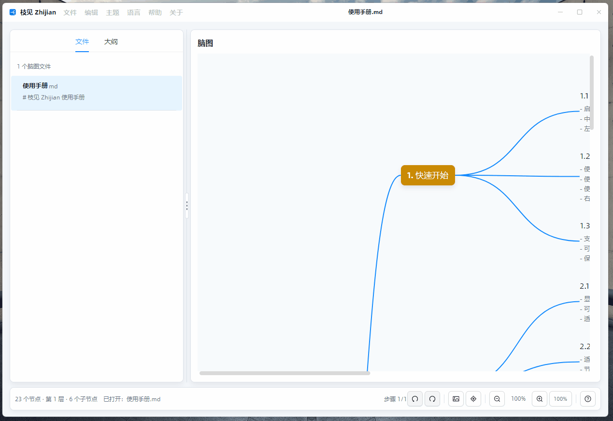

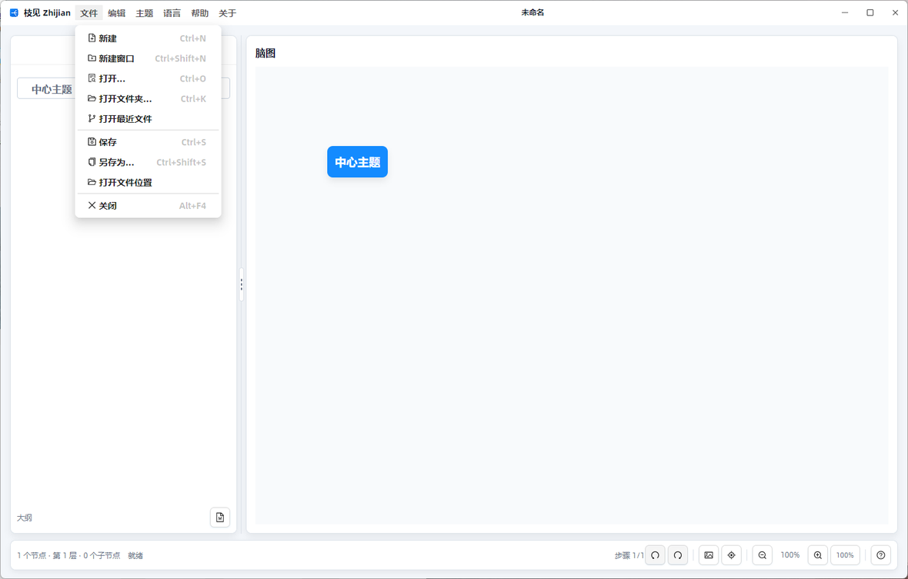

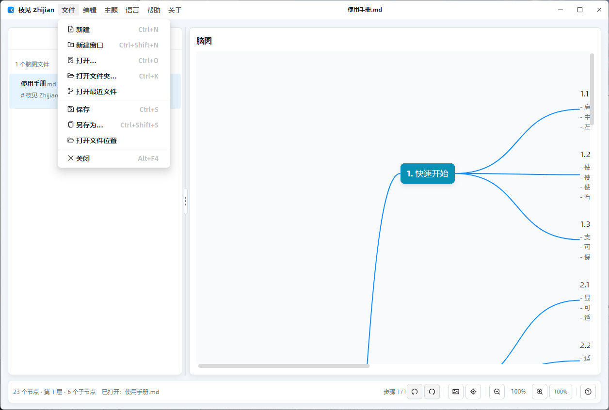

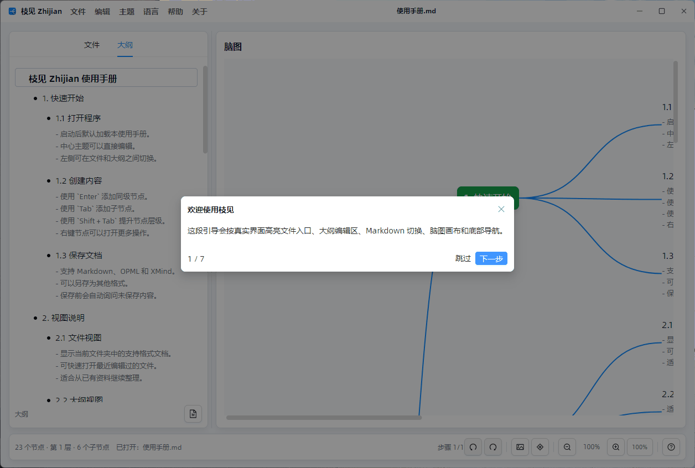

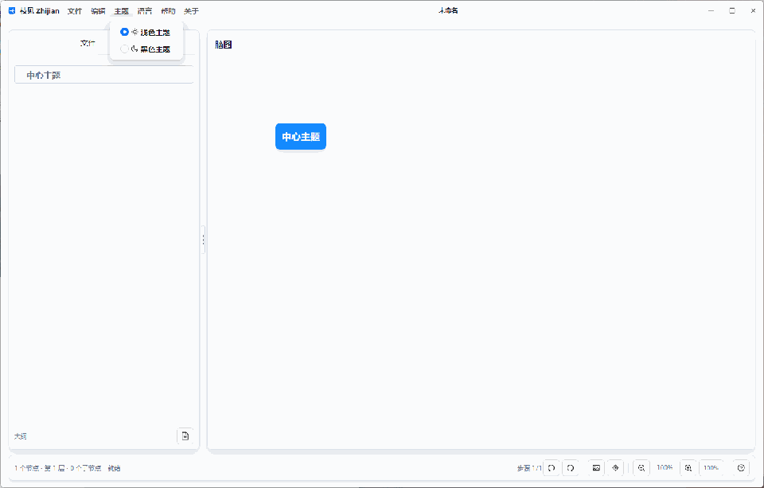

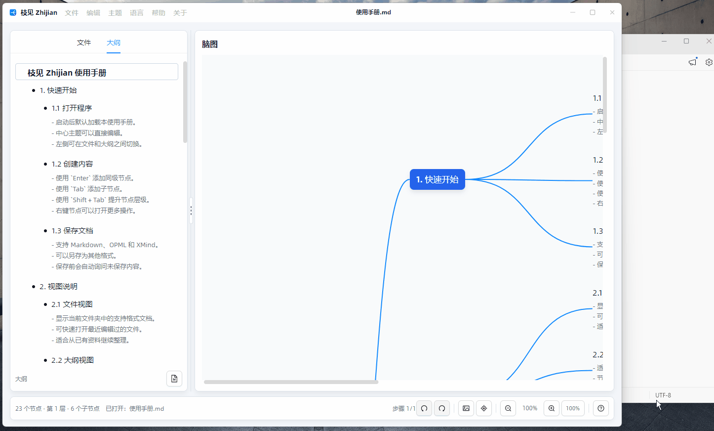

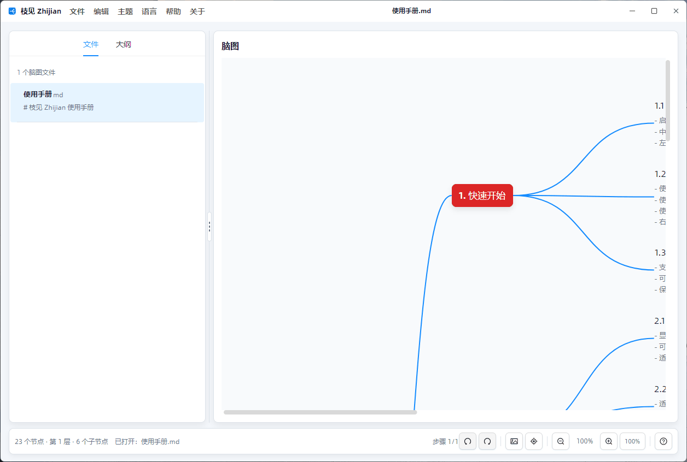

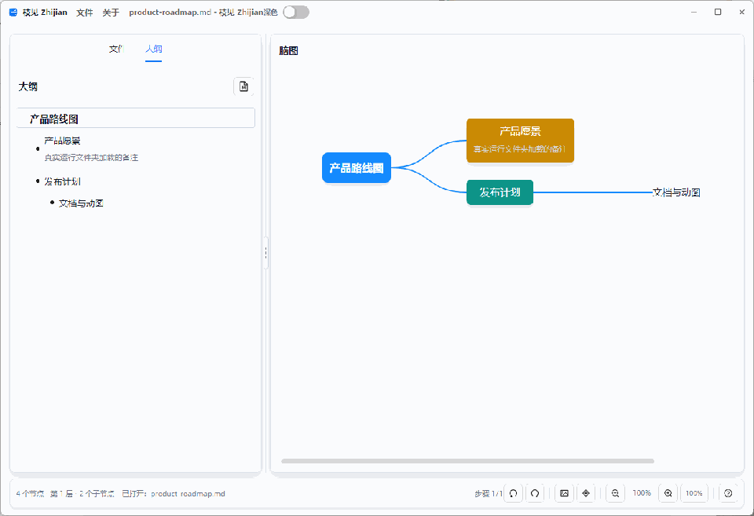

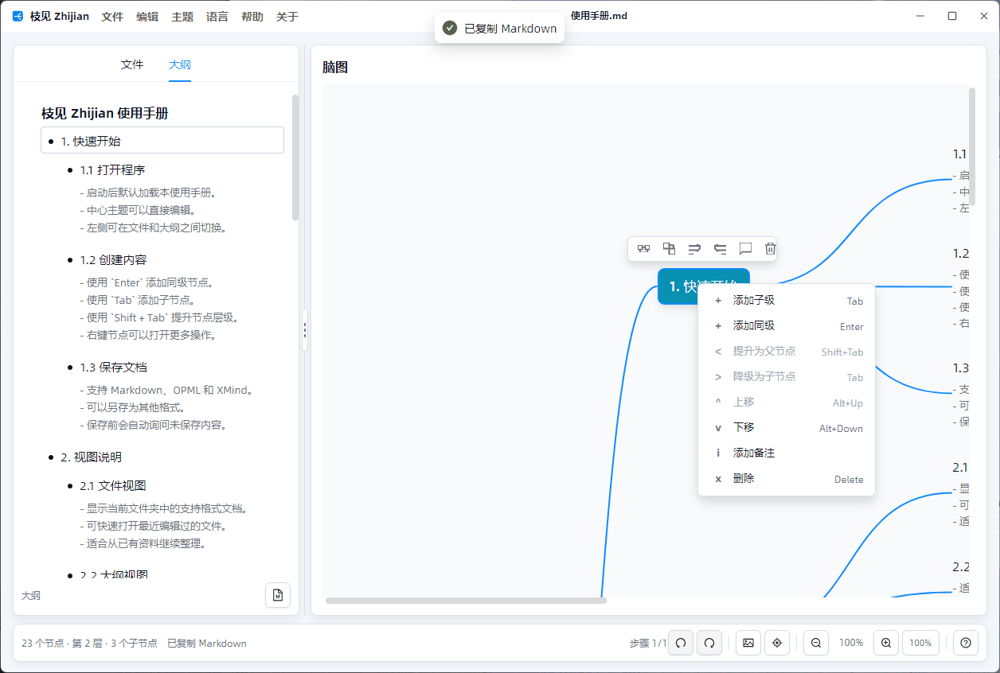

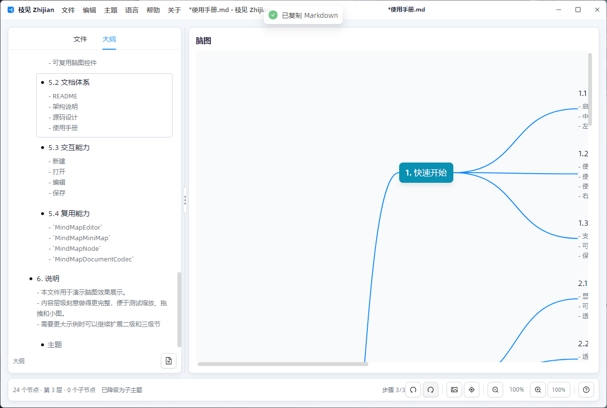

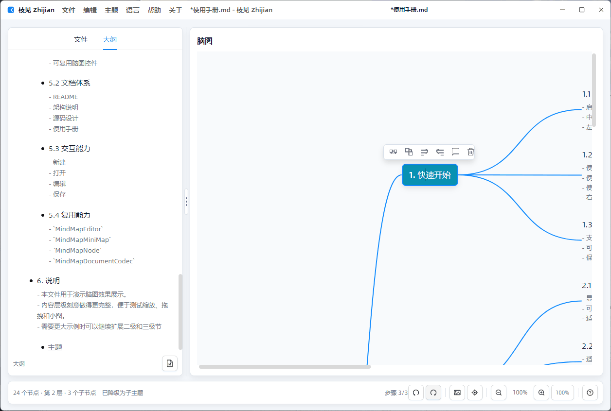

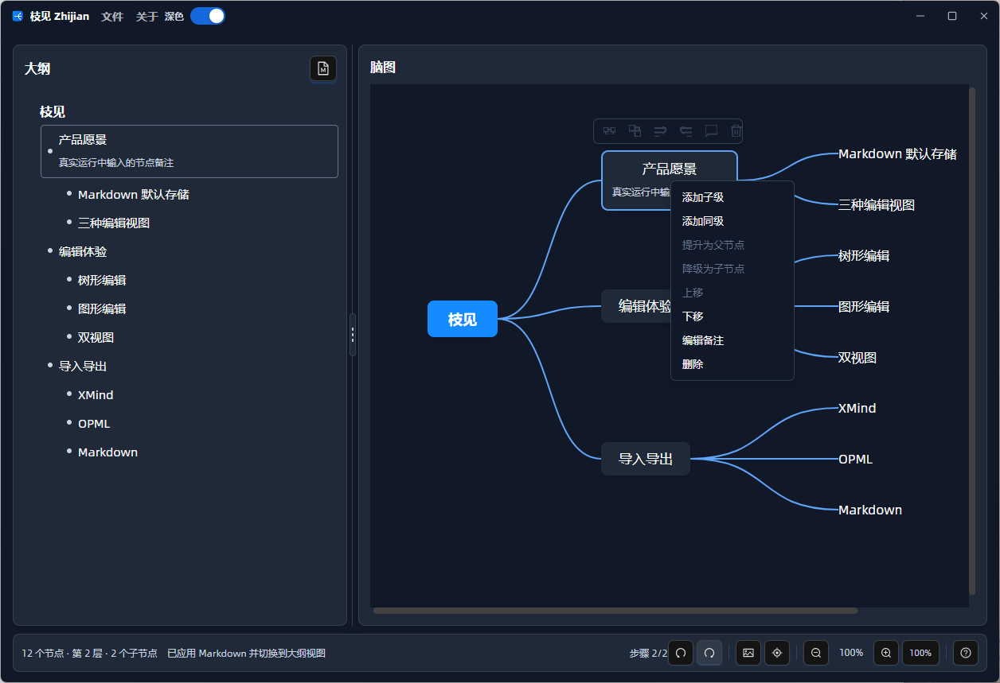

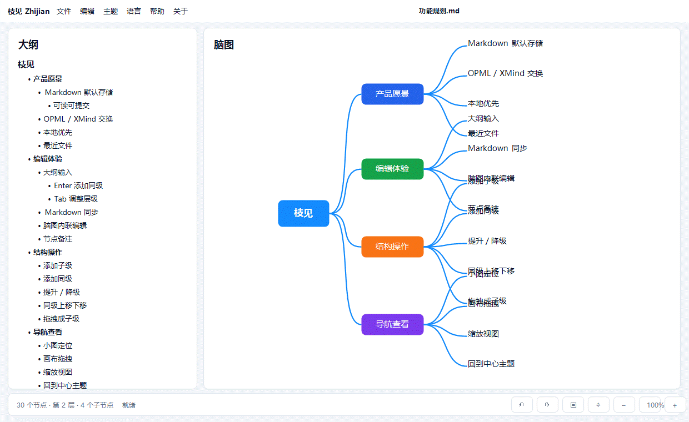


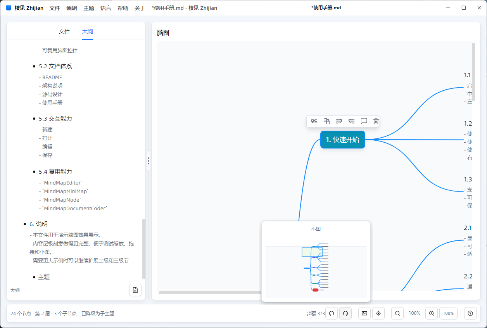


## 编辑流程

左侧是主要输入区。使用大纲模式快速组织层级；需要纯文本维护时切换到 Markdown；右侧脑图会从同一份数据实时刷新。

节点标题编辑时常用快捷键：

- `Enter`：添加同级节点。在中心主题上按 `Enter` 会添加子节点。
- `Tab`：将当前节点降级为上一个同级节点的子节点。
- `Shift + Tab`：提升节点。
- `Alt + Up` / `Alt + Down`：在同级节点中上移或下移。
- `Delete` 或 `Backspace`：删除空的非根节点。
- `触控板双指捏合`：围绕指针位置缩放脑图。
- `触控板双指滑动` 或 `鼠标滚轮`：平移脑图画布。
- `⌘ + 鼠标滚轮`（macOS）或 `Ctrl + 鼠标滚轮`（Windows/Linux）：围绕指针位置缩放脑图。
- `Shift + 鼠标滚轮`：横向平移脑图画布。
- `拖拽中心主题`、`Space + 左键拖拽` 或 `鼠标中键拖拽`：拖拽脑图画布。
- `⌘ + L`（macOS）或 `Ctrl + L`（Windows/Linux）：回到中心主题。

## 文件格式

枝见默认使用可读 Markdown 保存。为避免数据丢失，另存为只提供稳定可写的可编辑格式：

- Markdown (`.md`, `.markdown`)
- OPML (`.opml`)
- XMind (`.xmind`)

其他脑图、draw.io、图片、Office、文档和数据文件可通过“导入...”转换成脑图后，再另存为上述可编辑格式。

## 复用 CodeWF.Avalonia.MindView

脑图库已迁到 [CodeWF.Avalonia](https://github.com/dotnet9/CodeWF.Avalonia) 仓库，枝见通过 NuGet 引用，不再携带库源码。新的 Avalonia 应用可以引用 `CodeWF.Avalonia.MindView`（内含主题），在 `App.axaml` 注册 `<mindThemes:MindViewThemes />`，然后在页面中使用 `MindMapEditor`。普通接入只需要绑定节点集合和当前选择：

```xml
<mind:MindMapEditor
    Roots="{Binding Roots}"
    SelectedNode="{Binding SelectedNode, Mode=TwoWay}" />
```

`MindMapEditor` 内置添加子级、添加同级、升降级、同级上下移动、删除、拖拽移动和自动布局。需要接入撤销历史、保存状态或业务规则时，再把 `Controller="{Binding}"` 指向实现 `IMindMapEditorController` 的宿主 ViewModel。`src/Zhijian` 是围绕可复用控件构建文件工作流、大纲编辑、Markdown 同步和桌面外壳的完整参考。

更完整的接入说明见 [docs/源码设计.md](docs/源码设计.md)。

## 项目结构

```text
Zhijian/
|-- src/Zhijian/                枝见桌面应用
|-- docs/                       架构和源码设计文档
|-- docs/media/                 文档截图和 GIF
|-- UpdateLog.md                更新日志
`-- Zhijian.slnx                解决方案文件
```

## 开源项目感谢

枝见的开发离不开这些优秀开源平台和项目：

- [Dotnet](https://dotnet.microsoft.com/zh-cn/)
- [Avalonia UI](https://avaloniaui.net/)
- [Semi.Avalonia](https://github.com/irihitech/Semi.Avalonia)
- [Ursa.Avalonia](https://github.com/irihitech/Ursa.Avalonia)
- [Semi.Avalonia](https://github.com/irihitech/Semi.Avalonia)
- [Ursa](https://github.com/irihitech/Ursa.Avalonia)
- [CodeWF.Avalonia](https://github.com/dotnet9/CodeWF.Avalonia)

## 开发

环境要求：

- .NET 10 SDK

常用命令：

```powershell
dotnet restore Zhijian.slnx
dotnet build Zhijian.slnx
dotnet run --project src/Zhijian/Zhijian.csproj -f net10.0
.\publish.bat
.\package_all.bat
.\package_all.bat --force
```

`package_all.bat` 会先调用 `publish.bat`，再在 `artifacts/release/` 下生成 `Zhijian-v<Version>-<RID>.zip`、SHA256 文件和 release manifest（zip 仅为本地产物；GitHub Release 资产为 Windows exe、Linux deb 与 macOS dmg 安装包）。
Release 压缩包会排除调试符号文件和嵌套 zip 文件。
已有产物默认不会覆盖；需要覆盖时使用 `package_all.bat --force`，或直接给 PowerShell 脚本传入 `-Force`。

### macOS 打包

macOS 给别人分发时建议打成 `.app` + `.dmg`，不要只发送 `dotnet publish` 输出目录。脚本会默认生成 Intel 和 Apple Silicon 两个安装镜像：

```bash
./package_macos.sh
```

只打 Apple Silicon：

```bash
./package_macos.sh osx-arm64
```

产物会输出到 `artifacts/macos/`。未配置证书时脚本会使用 ad-hoc 签名，适合本机测试；真正发给其他 macOS 用户时，建议使用 Developer ID 证书签名并公证：

```bash
CODESIGN_IDENTITY="Developer ID Application: Your Name (TEAMID)" \
NOTARIZE=1 \
NOTARY_KEYCHAIN_PROFILE=zhijian-notary \
./package_macos.sh all
```

脚本需要 .NET 10 SDK，会自动检查 `dotnet` 和 `$HOME/.dotnet/dotnet`。如果 SDK 安装在其他位置，可设置 `DOTNET_CMD=/path/to/dotnet`。

## 文档

- [架构说明](docs/架构说明.md)
- [源码设计](docs/源码设计.md)

## 第三方开源组件审计（2026-05-20）

检查方式：`dotnet restore Zhijian.slnx --configfile <local-nuget-config>`、`dotnet list Zhijian.slnx package --include-transitive`、NuGet `.nuspec`、NuGet.org 与源码仓库信息。优先接受 MIT / Apache-2.0 / BSD；LGPL-3.0 等其它开源协议在源码与传递依赖均可追溯时单独标注。

整改：

- `CodeWF.EventBus` pin 到本次修复后的 `3.4.5.4`。
- `CodeWF.Tools.Core` pin 到本次修复后的 `1.3.13.1`。
- `Tmds.DBus.Protocol` 从传递依赖 `0.92.0` pin 到 `0.93.0`。

| 包 | 使用范围 | 协议 | 源码/项目地址 | 结论 |
| --- | --- | --- | --- | --- |
| `Semi.Avalonia` / `Irihi.Ursa.Themes.Semi` | 主题、桌面控件与浮层 | MIT | https://github.com/irihitech | 开源主题和控件 |
| `Avalonia` / `Avalonia.Desktop` / `Avalonia.Fonts.Inter` | 桌面运行时 | MIT | https://github.com/AvaloniaUI/Avalonia | 通过 |
| `CodeWF.EventBus` / `CodeWF.Markdown.Lite.Themes` / `CodeWF.Tools.Core` / `Lang.Avalonia.Json` | 自研组件 | MIT | https://github.com/dotnet9 | 自研开源包，通过 |
| `ReactiveUI.Avalonia` | MVVM | MIT | https://github.com/reactiveui/reactiveui | 通过 |
| `VC-LTL` | Windows 兼容 | EPL-2.0 | https://github.com/Chuyu-Team/VC-LTL5 | 源码开放，按“非优先但可追溯”通过 |
| `YY-Thunks` | Windows 兼容 | MIT | https://github.com/Chuyu-Team/YY-Thunks | 源码开放，通过 |
| `Tmds.DBus.Protocol` | Avalonia Linux DBus 传递依赖 | MIT | https://github.com/tmds/Tmds.DBus | 通过，pin 到 `0.93.0` |

当前主题和控件由 Semi、Ursa 与 CodeWF.Avalonia 提供。脑图包不依赖桌面外壳主题框架；有效还原后的依赖清单由 `dotnet list src/Zhijian/Zhijian.csproj package --include-transitive` 检查。

## 包版本维护约定

XML 文件统一使用两个空格缩进。`Directory.Packages.props` 统一承载 NuGet 中央包管理开关和包版本变量，包括 `AvaloniaVersion` 等共享版本属性；`Directory.Build.props` 仅保留项目构建、编译选项和 NuGet 元数据。仓库如引用 `VC-LTL`、`YY-Thunks`，这两个兼容旧版操作系统的特殊包必须使用最新预览版。

## CI/CD：自动发布

脑图库的打包与 NuGet 发布统一在 CodeWF.Avalonia 仓库进行。枝见的 `v*` 标签仅发布产品安装包。

**[release.yml](.github/workflows/release.yml)**：构建桌面安装包并创建 GitHub Release——
- Windows：NativeAOT 自包含发布 + Inno Setup 简体中文向导 `Zhijian-v版本-win-x64-setup.exe`
- Linux：自包含发布 + `dpkg-deb` 打包 `Zhijian-v版本-linux-x64.deb`
- macOS：`package_macos.sh` 产出 `Zhijian-版本-osx-arm64.dmg` / `osx-x64.dmg`（可按需加签名/公证）

手工发布步骤：

```bash
# 1. 升版本：修改 Directory.Build.props 的 <Version> 并提交
# 2. 打标签并推送，两个工作流同时触发
git tag -a v12.1.0.5 -m "Zhijian v12.1.0.5"
git push origin v12.1.0.5
# 3. 到 GitHub Actions 观察 publish-nuget 与 release 两个运行
```

## 发布

标准发布流程与发布说明规范见 [docs/RELEASE.md](docs/RELEASE.md)。

## 历史原生界面演示

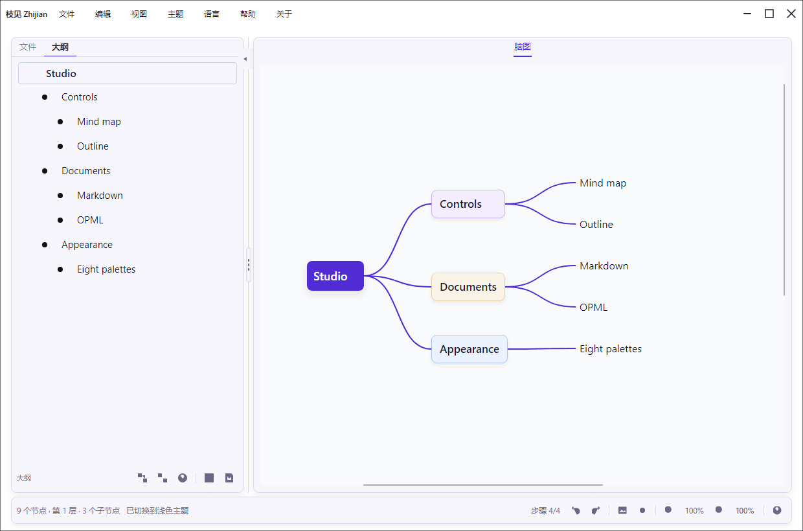

以上 GIF 保留自历史原生界面演示，本轮未重新录制；实际录制构建版本未知。当前 12.1.0.17 的原生检查结果见[验收记录](docs/UI-VERIFICATION.md)，当前截图与来源见文首及[媒体复核记录](docs/recheck24-native-media.md)。

## 统一安装体验

安装包采用统一 .NET 品牌紫设计：Windows 使用异形原生向导、真实进度核心和双语许可；macOS 使用品牌 DMG 背景与 Finder 拖放布局；Linux 提供原生 DEB 及 AppStream 品牌信息。各仓库保存自包含安装器源码，交付 EXE / DEB / DMG 和 SHA-256，不以 ZIP 代替安装包。实现、维护流程与平台验收边界见 [安装器说明](scripts/installer/README.md)。
