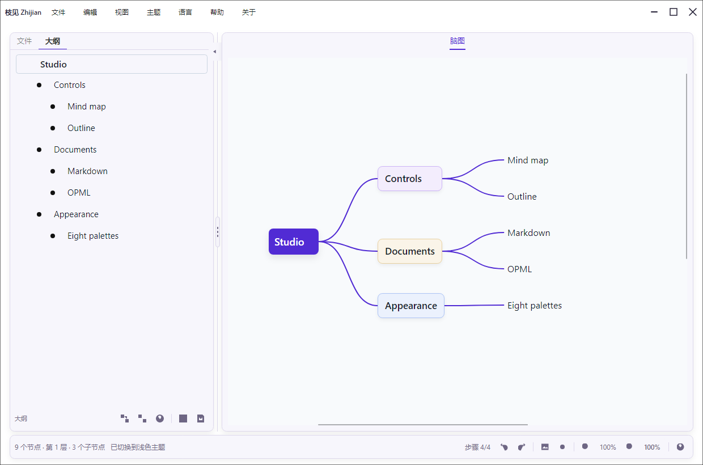
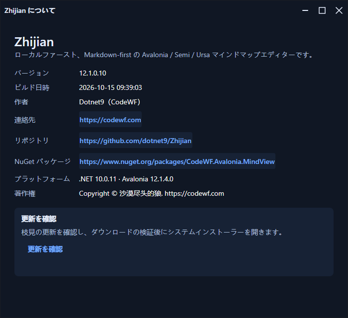

# 原型与原生界面验收

2026-10-15，版本 12.1.0.10。主界面保留文件 / 大纲左栏、Markdown 编辑切换、持续可见的脑图及底部操作栏；没有用修改原型来代替产品功能。原型补齐已实现的三态八色、四语言、关于和更新流程。

## 已执行

- 使用正式 NuGet 包 CodeWF.Avalonia 12.1.4.18；不含 AtomUI 依赖，`atomui` 分支保留旧方案。
- `scripts/publish.ps1 -RuntimeIdentifier win-x64` 成功，应用为 Windows NativeAOT 发布件。
- `scripts/ui-verification` 另行发布为 NativeAOT 后实际运行，139 项断言通过，输出 32 张 PNG。包括真实 MindView 节点编辑、撤销重做、Markdown / 大纲 / 脑图同步、八色浅深模式、系统模式、四语菜单、关于和保存窗口动态切语。
- 关于页显示实际应用程序集版本、编译时间、运行平台；更新检查、缺少下载资产、下载校验、手动安装、失败重试、取消及关闭期间取消使用受控服务验证，没有启动真实安装器。
- 无头浏览器遍历原型三态八色、四语言、两种窗口宽度及更新场景。原型和实现均采用 40 px 主标题栏、34 px 窗口按钮及可调左栏。

## 验证边界

上述截图由真实 XAML、ViewModel 和 NuGet 控件离屏渲染，原生验证器使用与产品相同的程序集和裁剪描述。锁屏期间没有操作真实桌面；这不能替代真实鼠标拖动、输入法、多 DPI、多显示器和其他操作系统验收。依赖库仍存在裁剪 / AOT 分析警告，已通过的路径不代表所有反射分支均被覆盖。

开发临时包只通过仓库外 NuGet 配置从 `temp_nugets` 恢复，正式仓库保留公开包版本。
